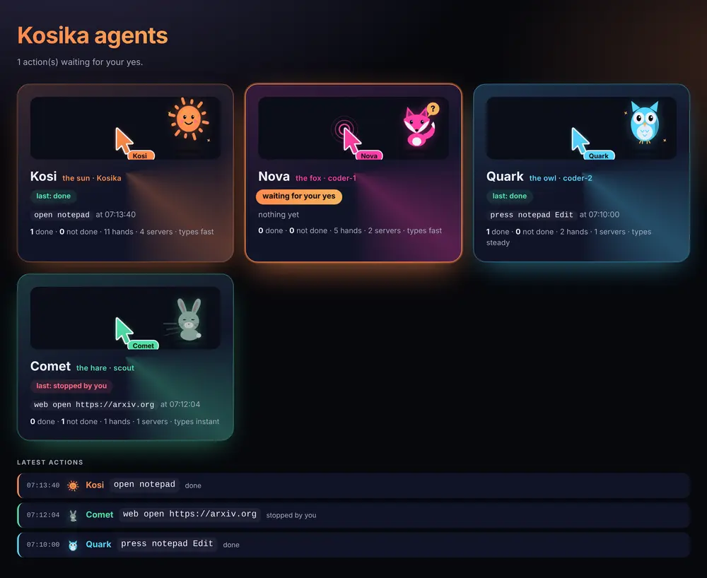
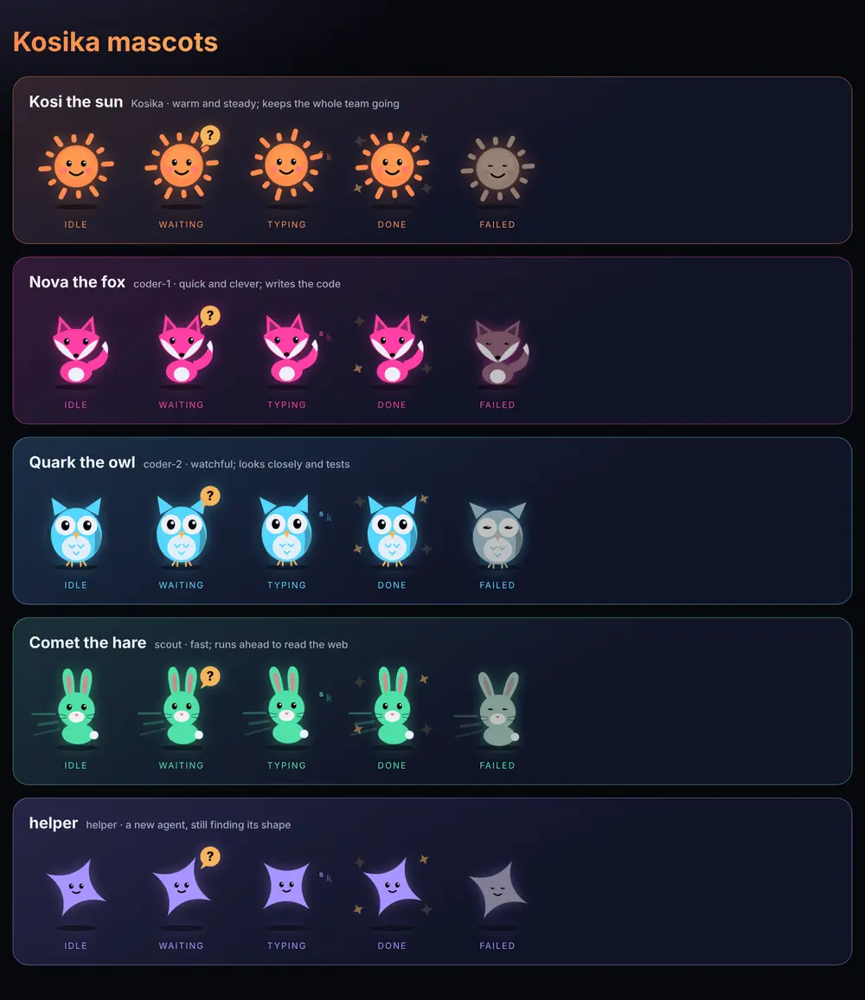
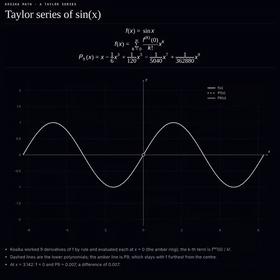

# kosika-agents

Every Kosika agent lives here. The [kosika](https://github.com/blackhole8080-darkmatter/kosika) repo keeps the language, its engines, the standard library and Studio; the agents are Kosika programs that run on it.

| Folder | What is in it |
| --- | --- |
| `agents/` | One folder per agent: coder, hands (kits, diary, team board, plan, learn, mascots), lookout, gatherer, desk, assistant, study, reader (whole books into study notes), researcher, osbuilder, digest and the rest |
| `swarm/` | The coder swarm and the project team (`develop.kos`, `team.kos`, `mind.kos`) |
| `models/` | Kosika's virtual models: the free-model pool, the router (`choose.kos`) and training for its own small coder |
| `benchmarks/` | The coder, osbuild and researcher benchmarks, and the Python comparison |
| `tests/` | Every agent program must check and pass its own tests |

## Gallery

The agents have faces. Each one has a mascot with its own colour and a mood
for every state (idle, waiting for your yes, typing, done, failed), and the
team board shows each agent's cursor, its last action and what waits for you.

<p></p>

<p></p>

When an agent needs maths it draws it with Kosika's white-line library, and
Kosi, the assistant, is a living cell that changes shape with the topic.

<table>
<tr>
<td></td>
<td></td>
</tr>
<tr><td>Kosi, a living cell</td><td>A Taylor series, drawn by an agent</td></tr>
</table>

**More, moving and live in 3D, in the
[Kosika Gallery](https://blackhole8080-darkmatter.github.io/kosika-site/gallery/).**

## Setting up

Keep this repo next to `kosika`, in one folder:

```
projects/
  kosika/
  kosika-agents/
```

One line, from that folder:

```
git clone https://github.com/blackhole8080-darkmatter/kosika-agents
```

The scripts find the engine in the `kosika` folder beside this one. If yours is somewhere else, point `KOSIKA_HOME` at it. Kosika Studio finds the agents the same way, or through `KOSIKA_AGENTS_HOME`.

Run an agent:

```
kosika run agents/researcher/main.kos --input ask.json
kosika studio agents
```

Run the tests:

```
python -m pytest tests
```

## History

These folders were moved out of `kosika` (`examples/agents`, `examples/self_improve`, `examples/virtual_models` and four benchmarks) with their full git history, so `git log` on any file still shows how it grew. The coder's to-do list stays in kosika as `CODER_TODO.md`, because its requests are changes to Kosika itself.

## License

MIT, like Kosika.
